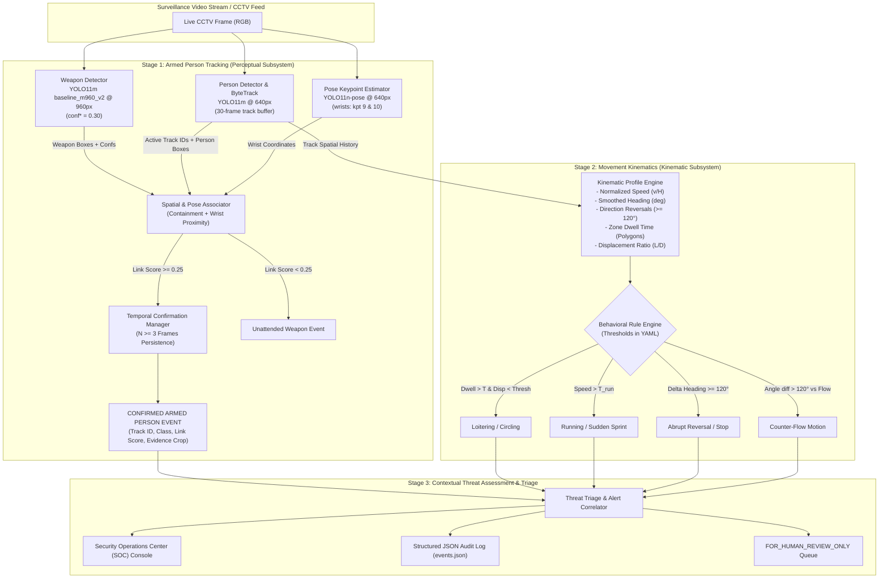

# Surveillance Threat Detection System (STDS)

[](https://www.python.org/downloads/)
[](https://pytorch.org/)
[](https://github.com/ultralytics/ultralytics)
[](https://opensource.org/licenses/MIT)

> **Core System Concept:**  
> **Threat Detection is the primary objective; weapon detection is a perceptual subsystem within it.**  
> Traditional weapon detectors treat CCTV frames as independent static photographs, generating false alarms on phones, tools, and harmless objects while failing to answer the critical questions:  
> *Who is holding the weapon? Where are they moving? Is there an active threat or anomalous behavior?*  
>  
> The **Surveillance Threat Detection System** transforms raw CCTV video into structured threat intelligence by coupling high-resolution weapon detection, persistent multi-person tracking, wrist keypoint association, and 2D kinematic behavioral analysis.

---

## 1. System Architecture



---

## 2. Key Modules & Directory Layout

```
threat-detection/
├── configs/                          # System configurations
│   ├── detection/                    # Weapon detector YAMLs & reproducibility manifests
│   └── pipeline/                     # Baseline pipeline parameters
├── src/
│   ├── pipeline/                     # Stage 1: Armed Person Tracking Subsystem
│   │   ├── detector.py               # Weapon detector wrapper (baseline_m960_v2 @ 960px)
│   │   ├── tracker.py                # ByteTrack multi-person tracker with gap tolerance
│   │   ├── pose.py                   # YOLO11-pose wrist keypoint extractor with fallback
│   │   ├── associator.py             # Spatial containment & wrist proximity matching
│   │   ├── temporal.py               # N=3 persistence filter, alert records, crop export
│   │   └── engine.py                 # Master pipeline coordinator & stream visualizer
│   ├── behavior/                     # Stage 2: Kinematic Behavior Analysis Subsystem
│   │   ├── kinematics.py             # Speed (v/H), heading, reversals, dwell time, L/D
│   │   ├── rules.py                  # Loitering, running, reversal, counter-flow rules
│   │   └── visualizer.py             # 2D trajectory maps and telemetry video overlay
│   └── detection/                    # Dataset reconciliation, audit & baseline scripts
├── tests/                            # Automated test suites (21 unit tests, 100% pass)
│   ├── test_pipeline_association.py  # 7 synthetic tests (determinism, nearest wrist, gaps)
│   ├── test_behavior_rules.py        # 8 synthetic tests (normal walk, loiter, run, edge cases)
│   └── test_dataset_integrity.py     # Leakage, coordinate bounds, and dHash verification
├── docs/                             # Engineering specifications & experiment logs
│   ├── STAGE1_PIPELINE.md            # Stage 1 design, frozen thresholds, limits & caveats
│   ├── STAGE2_MOVEMENT.md            # Stage 2 kinematic math, rules & operational limits
│   └── BASELINE_ERROR_ANALYSIS.md    # Leak-free evaluation, bootstrap CIs & diagnostic report
├── STAGE1_DONE.md                    # Review package & 15-minute verification checklist
├── reproducibility_manifest.json     # Frozen config SHA256 & parameter manifest
└── outputs/                          # Evaluation metrics, audit sheets & JSON event logs
```

---

## 3. Subsystem Breakdown

### Subsystem 1: Weapon Detection & Person Association (Stage 1)
- **Weapon Detector:** YOLO11m trained at 960px (`baseline_m960_v2 best.pt`). Operating threshold $\text{conf}^* = 0.30$ tuned strictly on `valid` to maximize $F_1$.
- **Person Tracking:** YOLO11m person detector with ByteTrack (`track_buffer=30`), configured specifically to bridge CCTV frame stride gaps ($\Delta f \approx 2-4$).
- **Pose-Aware Association:** Computes weapon-to-person affinity using:
  1. Box containment / IoA: $\text{IoA} = \frac{\text{Area}(W \cap P)}{\text{Area}(W)}$
  2. Proximity to nearest wrist relative to person height ($d_{wrist} / H_{person}$)
  3. Center-in-box check
  4. Minimum link score threshold $\tau_{link} = 0.25$
- **Temporal Persistence:** Rejects single-frame false alarm blips by requiring $N \ge 3$ confirmed association frames before generating a verified `CRITICAL_ALERT`.

### Subsystem 2: Behavioral Kinematics & Movement Analysis (Stage 2)
- **Bias Safeguard:** Features are computed **strictly from 2D bounding-box spatial coordinates** (centroid, width, height, foot point). **Zero appearance, clothing, demographic, racial, or facial features are used.**
- **Normalized Velocity ($v / H$):** Speed is normalized by bounding box height to mitigate perspective foreshortening across overhead camera frustums.
- **Direction Reversal:** Detects sharp angular deviations ($\Delta \theta \ge 120^\circ$) while in motion.
- **Zone Geofencing:** Polygon point-in-polygon tests accumulate zone residency and dwell time.
- **Displacement Ratio ($R_{disp} = D_{net} / L_{path}$):** Distinguishes linear transit ($R \approx 1.0$) from localized circling or pacing ($R \ll 0.25$).

### Subsystem 3: Contextual Threat Decision & Alerts (Stage 3)
- **Rules Evaluated:**
  - `RULE-LOITER`: Dwell time $\ge 10\text{ s}$ AND displacement ratio $\le 0.25$.
  - `RULE-RUN`: Normalized speed $\ge 0.10\text{ heights/frame}$ (sprint / sudden rush).
  - `RULE-REVERSE`: Direction turn $\ge 120^\circ$ while in motion.
  - `RULE-FLOW`: Heading opposing dominant crowd vector by $\ge 120^\circ$.
- **Ethical Safeguard:** Every behavioral alert is permanently stamped with `status: "FOR_HUMAN_REVIEW_ONLY"` and stores the exact numerical measurements that triggered the rule.

---

## 4. Benchmark Highlights

| Subsystem / Metric | Measured Value | Context & Hardware |
|---|:---:|---|
| **Pipeline Latency** | **59.6 ms (16.8 FPS)** | NVIDIA RTX A2000 12GB (Detector 960px + Tracker 640px + Pose 640px) |
| **Oracle Association Share (Innovatus CCTV)** | **96.0% (72 / 75)** | Association accuracy independent of detector |
| **End-to-End Detected Weapons Linked** | **95.5% (21 / 22)** | 95.5% of detected surveillance weapons linked to actors |
| **Track ID Switches on CCTV Stretches** | **0 switches** | Across all 3 continuous sequences (`seq02`, `seq07`, `seq08`) |
| **Spurious Alert Events on Empty Sequences** | **0 false alerts** | Single-frame detector noise suppressed by $N=3$ temporal filter |
| **Unit Test Coverage** | **21 / 21 Passed (100%)** | Synthetic association, behavior rules, and dataset integrity |

---

## 5. Quickstart & Verification

### 1. Environment Setup
```bash
# Clone the repository
git clone https://github.com/Doffcode/threat-detection.git
cd threat-detection

# Activate virtual environment
source work/.venv/bin/activate
pip install -r requirements.txt
```

### 2. Run Synthetic Test Suites
All pipeline behaviors, edge cases, and determinism constraints are verified automatically:
```bash
# Run association pipeline unit tests (7 tests: determinism, nearest-wrist, track gaps)
pytest tests/test_pipeline_association.py -v

# Run behavioral kinematics unit tests (8 tests: normal walk, loiter, run, edge cases)
pytest tests/test_behavior_rules.py -v

# Run complete test suite (21 tests)
pytest tests/ -v
```

### 3. Run Pipeline Inference
```bash
# Run Stage 1 Armed Person Tracking on CCTV sequences
python scripts/pipeline/evaluate_pipeline_full.py

# Run Stage 2 Behavioral Kinematics & Rule Engine
python scripts/behavior/run_behavior_analysis.py
```

---

## 6. Operational Boundaries & Ethical Disclaimers

> [!CAUTION]
> 1. **No Concealed Weapon Detection:** The system operates exclusively on visible RGB optical light. It **cannot and does not detect concealed weapons** (e.g. firearms inside waistbands, holstered under jackets, tucked behind pockets, or hidden inside bags). It alerts solely on visible, drawn, or holstered weapons presenting identifiable contours.
> 2. **Association Accuracy Unjudged by AI:** Association accuracy is not self-judged. It is presented via an unjudged **40-case Association Audit Sheet** ([`outputs/pipeline/audit_sheet/association_audit_sheet.csv`](file:///home/shiva/Desktop/projects/akriti/weapon-detection/outputs/pipeline/audit_sheet/association_audit_sheet.csv)) for human user adjudication.
> 3. **Behavior Alerts are for Human Review Only:** Behavioral alerts are contextual indicators to prioritize human operator attention. **They are NEVER labeled as "threat confirmed" or "crime detected".**
> 4. **Single-Camera Evaluation:** CCTV benchmarks are currently evaluated on continuous stretches from overhead camera `innovatus_cam_b`. Generalization across varied camera heights and outdoor weather remains subject to multi-camera field trials.

---

## 7. License & Citation

This project is licensed under the MIT License. If you use this threat detection pipeline or benchmarking methodology, please cite the project repository:

```bibtex
@misc{threat_detection_2026,
  author = {Doffcode},
  title = {Surveillance Threat Detection System: Multi-Stage Armed Person Tracking and Behavioral Kinematics},
  year = {2026},
  publisher = {GitHub},
  howpublished = {\url{https://github.com/Doffcode/threat-detection}}
}
```
