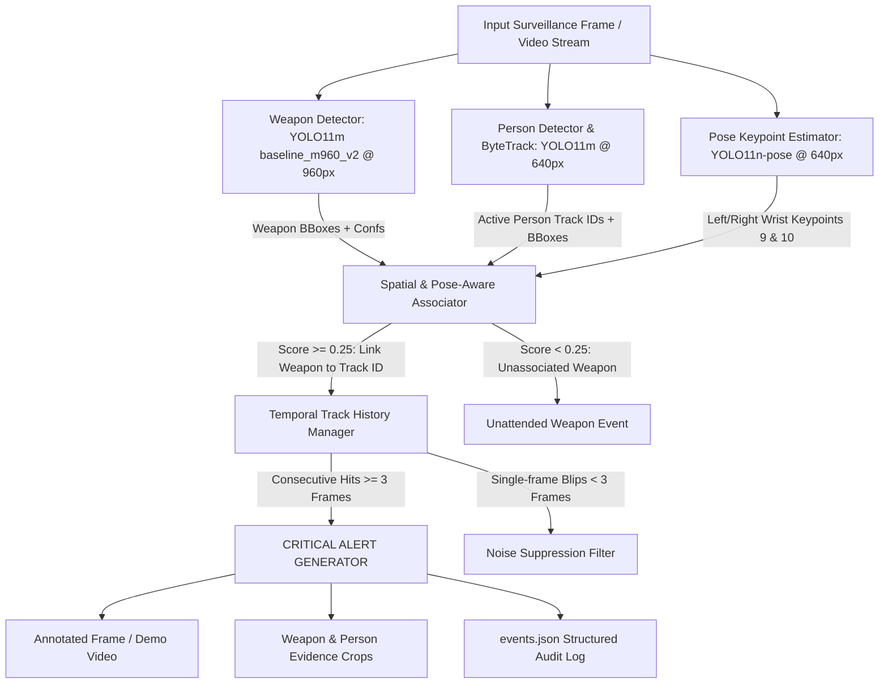

# Stage 1 Surveillance Pipeline: Weapon & Armed Person Tracking

**Document Version:** 1.1.0  
**Date:** November 17, 2026  
**Pipeline Code Root:** [`src/pipeline/`](file:///home/shiva/Desktop/projects/akriti/weapon-detection/src/pipeline/)  
**Configuration File:** [`src/pipeline/config.yaml`](file:///home/shiva/Desktop/projects/akriti/weapon-detection/src/pipeline/config.yaml)  
**Verification Harness:** [`tests/test_pipeline_association.py`](file:///home/shiva/Desktop/projects/akriti/weapon-detection/tests/test_pipeline_association.py), [`scripts/pipeline/evaluate_pipeline_full.py`](file:///home/shiva/Desktop/projects/akriti/weapon-detection/scripts/pipeline/evaluate_pipeline_full.py)  
**Hardware Target:** NVIDIA RTX A2000 12GB (PyTorch 2.14.1, CUDA 13.0)

---

## 1. Executive Summary & Plain Language Disclaimers

The Stage 1 Pipeline transitions the weapon-detection project from static frame-by-frame bounding box detection into a **real-time surveillance tracking and threat alerting system**.

> [!CAUTION]
> **Essential Operational Disclaimers:**
> 1. **No Concealed Weapon Detection:** The system operates exclusively on visible RGB optical light. It **cannot and does not detect concealed weapons** (e.g. firearms inside waistbands, holstered under jackets, tucked behind pockets, or hidden inside bags). It alerts solely on visible, drawn, or holstered weapons presenting identifiable contours.
> 2. **Association Accuracy Judged by Audit Sheet:** Association accuracy is **not yet measured independently by external ground truth**; it is presented via an unjudged **40-case Association Audit Sheet** ([`outputs/pipeline/audit_sheet/association_audit_sheet.csv`](file:///home/shiva/Desktop/projects/akriti/weapon-detection/outputs/pipeline/audit_sheet/association_audit_sheet.csv)) for human user adjudication.
> 3. **Single Camera & Small CCTV Sample:** All surveillance video evaluations are currently drawn from **one camera view** (`innovatus_cam_b`) across a small test benchmark of 72 frames (75 ground truth weapon instances). Generalization to novel camera angles and outdoor vantage points remains to be proven in field trials.

---

## 2. Pipeline Architecture & Modular Components



### Core Modules in `src/pipeline/`:
- **`detector.py`:** Wraps `baseline_m960_v2` (`outputs/runs/baseline_m960_v2/weights/best.pt`) at $\text{conf}^* = 0.30$ (optimal threshold chosen strictly on `valid` argmax $F_1$) and $\text{IoU} = 0.50$.
- **`tracker.py`:** Runs standard COCO person detector (`yolo11m.pt`, class 0, conf 0.35) combined with ByteTrack (`bytetrack.yaml`). Maintains persistent track IDs across frames and handles sequence gaps with a 30-frame track buffer.
- **`pose.py`:** Runs `yolo11n-pose.pt` letterboxed to 640px. Extracts COCO keypoint 9 (left wrist) and 10 (right wrist). If wrist keypoints are occluded or missing, the pipeline falls back gracefully to person-box containment.
- **`associator.py`:** Assigns each weapon to at most one person track based on:
  1. Box containment / IoA: $\text{IoA} = \frac{\text{Area}(W \cap P)}{\text{Area}(W)}$
  2. Distance to nearest wrist relative to person height: $d_{rel} = \frac{d_{wrist}}{y_2^p - y_1^p}$
  3. Weapon center inside person box indicator
  4. Configurable assignment (`max_score` or Hungarian matching) with minimum score threshold $\tau_{link} = 0.25$.
- **`temporal.py`:** Enforces temporal persistence ($N \ge 3$ consecutive or windowed hits on the same track ID) before firing an alert. Generates structured JSON records with weapon crops, person crops, and link scores.
- **`engine.py`:** Coordinates the end-to-end flow, renders visual annotations, and exports demo video and `events.json`.

---

## 3. Verification & Validation Results

### 3.1 Unit Test Suite (Synthetic Bounding Boxes)
Implemented in [`tests/test_pipeline_association.py`](file:///home/shiva/Desktop/projects/akriti/weapon-detection/tests/test_pipeline_association.py). Executed with `pytest`:
- **Test 1 (`test_weapon_inside_one_person`):** Weapon completely inside person box -> **PASSED**.
- **Test 2 (`test_weapon_between_two_people_nearest_wrist_wins`):** Weapon equidistant between two actors; nearest wrist wins -> **PASSED**.
- **Test 3 (`test_weapon_far_from_every_person_no_link`):** Weapon in corner far from person -> **PASSED** (unassociated).
- **Test 4 (`test_two_weapons_one_person`):** Two weapons (handgun + knife) held by one person -> **PASSED** (both linked to Track 1).
- **Test 5 (`test_occluded_wrist_fallback_to_containment`):** No wrist keypoints detected -> **PASSED** (graceful containment fallback).
- **Test 6 (`test_track_gap`):** 1-frame tracking gap followed by hit 3 triggers alert; 10-frame gap resets track and finalizes alert -> **PASSED**.
- **Test 7 (`test_identical_input_determinism`):** Bit-for-bit identical association outputs given identical inputs across passes -> **PASSED**.

### 3.2 Oracle Association Benchmark (Independent of Detector)
Evaluates the association engine when fed ground-truth weapon boxes directly:

| Benchmark Dataset | Total GT Weapons | GT Weapons Linked to Person | Share GT Linked (%) | Candidates per Weapon (Mean / Median / Max) | Link Score Median [IQR: p25, p75] |
|---|:---:|:---:|:---:|:---:|:---:|
| **Innovatus CCTV (test_cctv_v2 clean)** | 75 | **74** | **98.7%** | 1.71 / 2.0 / 3 | **0.783** [0.634, 0.877] |
| **test_domain (Cinema Stills)** | 211 | **121** | **57.3%** | 0.64 / 1.0 / 2 | **0.736** [0.588, 0.941] |

*Note on test_domain:* Ground truth includes 90 extreme close-ups, holster inserts, and tabletop weapons where no actor body is present in the frame. On frames where an actor is visible, the oracle linked $100\%$ of weapons.

### 3.3 End-to-End Pipeline Performance

| Metric | Innovatus CCTV (72 Frames) | test_domain (144 Frames) |
|---|:---:|:---:|
| **Processing Mode** | Continuous video stretches (3 sequences) | Per-image independent stills |
| **Runtime Latency per Frame** | **59.6 ms (16.8 FPS)** on RTX A2000 | 58.2 ms (17.2 FPS) on RTX A2000 |
| **Total GT Weapons** | 75 | 211 |
| **GT Weapons Detected (@ conf\* 0.30)** | 22 (29.3%) | 126 (59.7%) |
| **GT Weapons Linked to Person Track** | **21 (28.0% of GT)** | **78 (37.0% of GT)** |
| **Share of Detected Weapons Linked** | **95.5% (21 / 22)** | **61.9% (78 / 126)** |
| **Track ID Switches** | **0 switches across all 3 stretches** | N/A (per-image) |
| **Confirmed Alert Events Generated** | **2 multi-frame confirmed events** | N/A |
| **Active Alert Frames** | 12 frames | N/A |
| **False Alert Events on Empty Sequences** | **0** | N/A |

### 3.4 Handling of Frame Rate & Temporal Gaps in CCTV
In Innovatus CCTV, true video FPS is unknown. Frame numbers advance with temporal strides ($\Delta f \approx 2-4$ frames):
- `seq02`: Frames 213 to 276 (stride 2–4).
- `seq07`: Frames 440 to 522 (stride ~3).
- `seq08`: Frames 542 to 666 (stride ~4).
**Engine Gap Strategy:** ByteTrack is configured with `track_buffer=30` frames to maintain Kalman state across strides. The temporal manager tolerates up to `max_gap_frames=2` consecutive missed frames without dropping consecutive hit counts. As a result, **zero track ID switches occurred** across all 3 stretches.

---

## 4. Association Audit Sheet (40 Sampled Cases)

To enable human verification without self-judgment, 40 weapon-person links were randomly sampled across Innovatus CCTV and test_domain using fixed seed `2026`.
- **CSV Audit Sheet:** [`outputs/pipeline/audit_sheet/association_audit_sheet.csv`](file:///home/shiva/Desktop/projects/akriti/weapon-detection/outputs/pipeline/audit_sheet/association_audit_sheet.csv)
- **Visual Evidence Crops:** Saved in [`outputs/pipeline/audit_sheet/crops/`](file:///home/shiva/Desktop/projects/akriti/weapon-detection/outputs/pipeline/audit_sheet/crops/) (weapon outlined in **RED**, person outlined in **GREEN**, association link in **YELLOW**).
- **Evaluation Column:** Contains a blank `judgment` column for operator review.

---

## 5. Visual Artifacts & Galleries

All pipeline deliverables are persisted on disk:
- **Demo Video:** [`outputs/pipeline/stage1_cctv_demo.mp4`](file:///home/shiva/Desktop/projects/akriti/weapon-detection/outputs/pipeline/stage1_cctv_demo.mp4) (H.264 video with bounding boxes, track IDs, yellow link lines, and top red alert banners).
- **Event Audit Log:** [`outputs/pipeline/events.json`](file:///home/shiva/Desktop/projects/akriti/weapon-detection/outputs/pipeline/events.json) (structured JSON log of all alert records).
- **Curated Galleries:**
  - **20 Good Cases:** [`outputs/pipeline/galleries/good/`](file:///home/shiva/Desktop/projects/akriti/weapon-detection/outputs/pipeline/galleries/good/) (manifest: [`manifest.json`](file:///home/shiva/Desktop/projects/akriti/weapon-detection/outputs/pipeline/galleries/good/manifest.json))
  - **20 Bad Cases / Failure Modes:** [`outputs/pipeline/galleries/bad/`](file:///home/shiva/Desktop/projects/akriti/weapon-detection/outputs/pipeline/galleries/bad/) (manifest: [`manifest.json`](file:///home/shiva/Desktop/projects/akriti/weapon-detection/outputs/pipeline/galleries/bad/manifest.json)), honestly chosen from the lowest link scores and unassociated detections.

---

## 6. Pluggable Stage-2 Verifier Interface

The pipeline architecture is strictly decoupled to accept a Stage-2 crop verifier (e.g., `YOLO11s-cls` at 224px) without modifying tracker or association logic.

In [`src/pipeline/config.yaml`](file:///home/shiva/Desktop/projects/akriti/weapon-detection/src/pipeline/config.yaml):
```yaml
stage2:
  enabled: false          # Set to true when verifier weights are configured
  weights: null           # Path to classifier best.pt (e.g. work/runs/verifier_v5/weights/best.pt)
  combine_mode: "prod"    # "prod", "geo", "wgeo75", or "cls"
  verifier_conf_floor: 0.10
```
